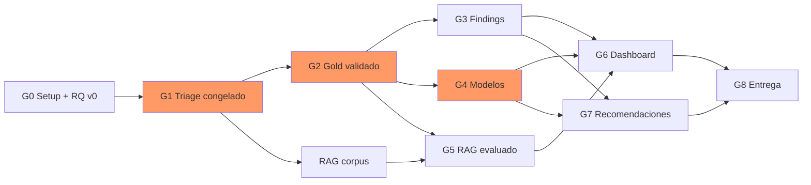

# Plan Ejecutivo — FlameSafe · Flames in Free Fall (NASA Space Apps 2026)

> **Versión vigente.** El [procedimiento de release](../06_submission/RELEASE_PROCEDURE.md) define el sitio, la reconstrucción y el cierre actuales. Las fases siguientes registran el alcance original.

> **Estado:** v1.0 · **Horizonte:** 24 h (H+0 → H+24) · **Equipo:** SpacePunks
> **Cómo usar este documento:** es la fuente de verdad del *qué* y el *cuándo*. El avance real se marca en
> [MILESTONES.md](../01_management/MILESTONES.md) (checklist) y [PROGRESS.md](../01_management/PROGRESS.md) (tablero).
> Cualquier cambio de alcance se registra como ADR en [decisions/](../01_management/decisions/).

---

## 1. Visión del entregable

**Una frase:** un dashboard web, potenciado por IA, que convierte las 24 investigaciones de combustión de NASA PSI
en respuestas trazables para diseñar hábitats lunares/marcianos más seguros contra incendios.

**Propuesta de valor (lo que el jurado debe ver en 3 minutos):**

1. **Encontrar** — catálogo de las 24 investigaciones, *rankeado* por relevancia para cada pilar de seguridad
   (prevención · detección · supresión) y cada entorno (nave, estación, base lunar, rover presurizado, Marte).
2. **Comparar** — qué condiciones (combustible, O₂, presión, flujo, sensores) comparten y en qué difieren las investigaciones.
3. **Entender** — hallazgos estadísticos con interpretación física y su cita a la fila/archivo/DOI de origen.
4. **Predecir** — *Habitat Fire Risk Explorer*: el usuario fija O₂, presión, flujo y gravedad y obtiene indicadores de riesgo
   con incertidumbre y **advertencia explícita de extrapolación** (no hay datos de gravedad parcial en PSI).
5. **Preguntar** — asistente RAG que responde solo con evidencia citada (documentos + consultas a tablas gold).
6. **Actuar** — recomendaciones accionables y brechas de conocimiento → próximos experimentos (LUCI, FM2, etc.).

**Diferenciador:** honestidad científica verificable. Cada número en pantalla tiene procedencia (PSI-ID, archivo, sha256, fecha).

---

## 2. Alcance

| Nivel | Incluye |
|---|---|
| **MVP (obligatorio)** | Catálogo + ranking de las 24 investigaciones · pipeline bronze/silver/gold sobre tablas experimentales PSI + archivos seleccionados · 3+ hallazgos estadísticos con interpretación física · 1 modelo predictivo validado con incertidumbre · Habitat Risk Explorer · RAG con citas · dashboard desplegado · video/demo |
| **Stretch** | 2º/3º modelo (supresión FLEX, detección SAME-R) · series de tiempo SAFFIRE-III · comparación lado a lado avanzada · sección "Earth applications" · modo glosario para estudiantes |
| **Fuera de alcance** | Descargar el archivo completo (~13 TB) · visión por computadora sobre videos (tasas de propagación) · combustión de propelentes/cohetes · afirmar resultados en gravedad parcial como medidos |

---

## 3. Principios de trabajo (no negociables)

1. **Evidencia trazable:** nada se muestra sin procedencia. Nada se inventa; lo desconocido se etiqueta como desconocido.
2. **Preguntas primero:** las preguntas de investigación (G0/G3) definen qué tablas gold se construyen — no al revés.
3. **Demo-first / vertical slice:** a H+10 debe existir un flujo completo de punta a punta con *un* dataset, aunque sea feo.
4. **Gates:** no se avanza de fase sin cumplir el criterio de salida. Si un gate se atrasa, se recorta alcance (§10), no calidad.
5. **Física detrás de cada gráfica:** todo hallazgo/modelo tiene un párrafo de interpretación física revisado por el track PHY.
6. **Reproducibilidad:** `make pipeline && make train` regenera todo desde cero; semillas fijas; configs versionadas.
7. **Uso de fuentes de terceros:** el repo de referencia (equipo AFAQ) se usa como *mapa*, no se copia código (ver [ADR-0003](../01_management/decisions/ADR-0003-reference-repo-usage.md)). Todo número se re-verifica contra el API en vivo.

---

## 4. Arquitectura de la solución

```text
                ┌───────────────────────────── configs/*.yaml ─────────────────────────────┐
 NASA PSI API ──► INGESTION ──► BRONZE ──► SILVER ──► GOLD ──┬──► ANALYSIS (EDA, stats) ──► findings/*.md ──┐
 (search,         catalog +     raw +      typed,     harmonized│                                             │
  detail,         manifest      sha256     units,     per RQ    ├──► MODELS (train, CV, UQ, AD) ─► model_cards ─┤
  download)       downloads     sidecars   flags      DuckDB    │                                             │
                                                                ├──► RANKING (MCDA) ─────────────────────────┤
 Publications / DOIs / NASA pages ──────────────────────────────┴──► RAG corpus + index ◄────────────────────┘
                                                                                   │
                                                          DASHBOARD (Streamlit) ◄──┘  + tools SQL sobre gold
```

Stack propuesto (ADR-0001): Python 3.11 · pandas/pyarrow/DuckDB · pandera · statsmodels/scikit-learn/LightGBM/MAPIE/SHAP ·
Claude (Anthropic API) + embeddings locales + BM25 + LanceDB · Streamlit + Plotly · pytest + ruff + GitHub Actions.

---

## 5. Equipo y tracks

| Track | Código | Responsabilidad | Documentos que posee |
|---|---|---|---|
| Data Engineering | **DE** | API PSI, triage de 24 repos, pipeline medallion, calidad de datos | `docs/02_data_engineering/` |
| Data Science | **DS** | Preguntas de investigación, EDA, estadística, modelos, ranking | `docs/03_data_science/` |
| RAG / IA | **RAG** | Corpus, índice, asistente con citas, evaluación | `docs/03_data_science/RAG_DESIGN.md` |
| Physics | **PHY** | Literatura, marco de interpretación, atmósferas, recomendaciones | `docs/04_physics/` |
| App / Integración | **APP** | Dashboard, despliegue, UX | `docs/05_dashboard/` |
| Entrega | **SUB** | Video, pitch, página de Space Apps | `docs/06_submission/` |

Asignación de personas y RACI: [TEAM_AND_ROLES.md](../01_management/TEAM_AND_ROLES.md). Con equipo pequeño, RAG lo absorbe DS y APP lo absorbe DE desde H+12.

---

## 6. Cronograma (24 h)

```mermaid
gantt
    dateFormat  HH:mm
    axisFormat  H+%H
    title Plan 24h (H+0 = 00:00)
    section Gestión
    F0 Setup y alineación        :f0, 00:00, 2h
    section DE
    F1 Descubrimiento y triage   :f1, 01:00, 4h
    F2 Pipeline medallion        :f2, after f1, 6h
    section DS
    RQ borrador (G0)             :rq, 00:30, 2h
    F3 EDA y estadística         :f3, 07:00, 7h
    F4 Modelado predictivo       :f4, 10:00, 7h
    section RAG
    F5 RAG                       :f5, 06:00, 10h
    section PHY
    F7 Física (continuo)         :f7, 00:30, 20h
    section APP
    F6 Dashboard                 :f6, 08:00, 12h
    section Entrega
    F8 Freeze, video, submit     :f8, 20:00, 4h
```



| Hito | Hora objetivo | Gate |
|---|---|---|
| Kick-off cerrado, RQ borrador | H+2 | **G0** |
| 24 investigaciones triadas, datasets MVP congelados | H+5 | **G1** |
| Gold v1 validado (vertical slice de datos) | H+9 | **G2** |
| **Vertical slice end-to-end** (1 dataset → gráfica → página → pregunta RAG) | H+10 | — |
| **Scope freeze** (no entran features nuevas) | H+12 | — |
| Hallazgos estadísticos con interpretación física | H+14 | **G3** |
| Modelo(s) validados + model cards | H+17 | **G4** |
| RAG evaluado | H+16 | **G5** |
| Dashboard completo desplegado | H+20 | **G6** |
| Recomendaciones físicas aprobadas | H+20 | **G7** |
| **Code freeze** · video · submit | H+22 / H+24 | **G8** |

Rituales: *sync* de 10 min cada 4 h (H+4, H+8, H+12, H+16, H+20): cada track dice ✔ hecho / ▶ siguiente / ⛔ bloqueos, y se actualiza
[PROGRESS.md](../01_management/PROGRESS.md).

---

## 7. Fases, tareas y gates

Convención: cada tarea tiene **ID**, **prerrequisito**, **entregable** y vive en MILESTONES.md como checkbox.
Una fase puede empezar cuando sus prerrequisitos están cumplidos aunque la anterior no haya cerrado del todo
(ver ruta crítica §8), pero **su gate no se cierra** sin los gates de los que depende.

### F0 · Setup y alineación (H+0 → H+2)

**Objetivo:** todos trabajan sobre la misma base, con roles y preguntas claras.

| ID | Tarea | Prerrequisito | Entregable |
|---|---|---|---|
| PM-01 | Asignar personas a tracks y llenar RACI | — | TEAM_AND_ROLES.md |
| PM-02 | Entorno: `pip install -e ".[all]"`, `.env`, `pytest` verde en todas las máquinas | — | CI verde |
| PM-03 | Ratificar ADR-0001 (stack) y ADR-0003 (uso repo referencia) | — | ADRs `Accepted` |
| DS-01 | Borrador de preguntas de investigación (RQ1–RQ6) | lectura del reto | RESEARCH_QUESTIONS.md v0 |
| PHY-01 | Primer de física compartido (30 min de lectura para todos) | — | PHYSICS_PRIMER.md v1 |

**🚦 G0 — criterio de salida:** roles asignados · todos con entorno funcionando · RQ v0 acordadas por el equipo · ADRs aceptados.

### F1 · Descubrimiento de datos y triage (H+1 → H+5) — *ruta crítica*

**Objetivo:** saber exactamente qué hay en los 24 repositorios PSI y cuál es útil, con una metodología explícita y repetible.

| ID | Tarea | Prerrequisito | Entregable |
|---|---|---|---|
| DE-01 | Verificar endpoints PSI (search/detail/download) y registrar en log | G0 parcial (entorno) | DATA_SOURCES.md §verificación |
| DE-02 | `flamesafe catalog`: bajar JSON de detalle de las 24 investigaciones a bronze | DE-01 | `data/bronze/catalog/` |
| DE-03 | Aplanar inventario: investigaciones, archivos (`added`), tablas experimentales, publicaciones | DE-02 | `silver/catalog/*.parquet` |
| DE-04 | **Exploración de formato** por investigación (plantilla de perfil) — al menos las candidatas Tier 1/2 | DE-03 | `investigations/PSI-XX.md` |
| DE-05 | **Triage** con la rúbrica de [TRIAGE_METHODOLOGY.md](../02_data_engineering/TRIAGE_METHODOLOGY.md) → tiers + manifest de descarga | DE-04, DS-01 | `configs/triage.yaml` + `configs/acquisition_manifest.yaml` + ADR-0002 |
| PHY-02 | Mapear cada investigación a pilar (prevención/detección/supresión) y entorno; validar relevancia física del triage | DE-03 | columna PHY en matriz de triage |

**🚦 G1 — criterio de salida:** 24/24 investigaciones con perfil mínimo (metadatos + inventario) · matriz de triage con puntajes y
justificación · lista de datasets MVP **congelada** en ADR-0002 · manifest de descarga dentro del presupuesto (≤ 500 MB).

### F2 · Pipeline medallion (H+5 → H+10) — *ruta crítica*

**Objetivo:** tablas gold confiables, documentadas y regenerables, listas para estadística y modelos.

| ID | Tarea | Prerrequisito | Entregable |
|---|---|---|---|
| DE-06 | `flamesafe bronze`: descarga por manifest con sha256 + sidecar; 404s registrados | G1 | `data/bronze/PSI-XX/` + reporte de adquisición |
| DE-07 | `flamesafe silver`: un parser por familia de tabla (tipos, tokens faltantes → NULL+flag, unidades, procedencia) | DE-06 | `data/silver/*.parquet` |
| DE-08 | `flamesafe gold`: tablas armonizadas por RQ (definidas antes en DATA_DICTIONARY) | DE-07, DS-02 | `data/gold/*.parquet` + DuckDB |
| DE-09 | Contratos de calidad (pandera) + tests con fixtures en `data/sample/` | DE-07 | tests verdes + DATA_QUALITY report |
| DE-10 | Data dictionary de gold (columna, unidad, origen, transformación, caveats) | DE-08 | DATA_DICTIONARY.md |
| DS-02 | Especificar qué variables necesita cada RQ (contrato DS→DE) | DS-01, G1 | RESEARCH_QUESTIONS.md §variables |

**🚦 G2 — criterio de salida:** `make pipeline` corre de cero sin errores · validaciones pandera 100% · cada columna gold documentada
con unidad y procedencia · conteos de filas reconciliados con la fuente (bronze ↔ silver ↔ gold) · ningún token faltante convertido a 0.

### F3 · Preguntas de investigación, EDA y estadística (H+2 RQ · H+7 → H+14 EDA)

**Objetivo:** hallazgos con evidencia estadística sólida e interpretación física — la narrativa del dashboard.

| ID | Tarea | Prerrequisito | Entregable |
|---|---|---|---|
| DS-03 | Ratificar RQs finales y priorizarlas (MVP = RQ1, RQ2, RQ5; resto stretch) | G1 | RESEARCH_QUESTIONS.md v1 |
| DS-04 | EDA iterativo por RQ siguiendo [EDA_PROTOCOL.md](../03_data_science/EDA_PROTOCOL.md) | G2 (o silver si gold atrasa) | notebooks `02_eda/` |
| DS-05 | Pruebas estadísticas con tamaño de efecto + IC + corrección por comparaciones múltiples | DS-04 | funciones en `src/flamesafe/analysis/` |
| DS-06 | Redactar findings (plantilla) — mín. 3 para MVP | DS-05, PHY-03 | `findings/F-XX.md` |
| PHY-03 | Interpretación física de cada finding (mecanismo, consistencia con literatura, límites) | DS-05 | sección física de cada finding |
| DS-07 | Ranking de relevancia (MCDA) de las 24 investigaciones | G1, PHY-02 | `ranking` + RANKING_METHODOLOGY.md |

**🚦 G3 — criterio de salida:** ≥ 3 findings con: pregunta, datos (PSI-ID/archivo), método, estadístico + tamaño de efecto + IC,
figura reproducible, interpretación física aprobada por PHY, limitaciones · ranking reproducible con pesos documentados.

### F4 · Modelado predictivo (H+10 → H+17) — *la parte dorada*

**Objetivo:** modelos útiles para operaciones (umbrales de peligrosidad por condiciones de misión), honestos sobre su incertidumbre
y su dominio de aplicabilidad. Plan detallado: [MODELING_PLAN.md](../03_data_science/MODELING_PLAN.md).

| ID | Tarea | Prerrequisito | Entregable |
|---|---|---|---|
| DS-08 | Definir targets + baseline trivial + baseline físico (correlación/ley conocida) | G2, DS-03 | MODELING_PLAN §targets |
| DS-09 | Features con sentido físico (p. parcial O₂, fracción molar, Zst, Tad, flujo, diluyente) | DS-08, PHY-04 | `src/flamesafe/models/features.py` |
| DS-10 | Entrenar modelos interpretables primero (logística/GAM) → luego boosting con restricciones monótonas | DS-09 | `artifacts/models/` |
| DS-11 | Validación: GroupKFold por campaña/día de prueba; calibración; métricas vs. baselines | DS-10 | reporte de evaluación |
| DS-12 | Incertidumbre (conformal) + dominio de aplicabilidad (distancia a datos de entrenamiento) | DS-11 | intervalos + flag de extrapolación |
| DS-13 | **Umbrales de riesgo** para atmósferas de referencia (ISS, base lunar, Marte) con IC | DS-12, PHY-05 | tabla de umbrales + model card |
| PHY-04 | Validar que features y monotonías tengan sentido físico | DS-08 | comentarios en MODELING_PLAN |
| PHY-05 | Acotar gravedad parcial: µg y 1g como cotas (bounding), nunca interpolación presentada como dato | DS-12 | HABITAT_ATMOSPHERES §gravedad |

**🚦 G4 — criterio de salida:** ≥ 1 modelo que supera ambos baselines en CV agrupada · calibrado · intervalos de incertidumbre ·
dominio de aplicabilidad implementado · model card completa (datos, métricas, límites, uso previsto/no previsto) · revisión PHY firmada.

### F5 · RAG / Asistente (H+6 → H+16, paralelo)

**Objetivo:** navegar el dashboard y la evidencia preguntando en lenguaje natural, con citas y sin alucinaciones numéricas.
Diseño: [RAG_DESIGN.md](../03_data_science/RAG_DESIGN.md).

| ID | Tarea | Prerrequisito | Entregable |
|---|---|---|---|
| RAG-01 | Construir corpus: metadatos PSI (objetivos, enfoque, hardware), abstracts de publicaciones, docs propios | DE-03 | `artifacts/rag/corpus.jsonl` |
| RAG-02 | Índice híbrido (BM25 + embeddings) con chunks que conservan PSI-ID/DOI | RAG-01 | `artifacts/rag/index/` |
| RAG-03 | Herramientas estructuradas: consultas SQL parametrizadas sobre gold (DuckDB) | G2 | `src/flamesafe/rag/tools.py` |
| RAG-04 | Contrato de respuesta: citas obligatorias, rechazo sin evidencia, separación dato/interpretación | RAG-02 | prompt + validador |
| RAG-05 | Set de evaluación (≥ 20 preguntas con respuesta esperada y fuente) + métricas | RAG-04 | `docs/03_data_science/rag_eval.md` |

**🚦 G5 — criterio de salida:** ≥ 85% de respuestas del set de evaluación correctas y citadas · 0 números inventados en el set ·
rechaza correctamente preguntas fuera de evidencia · latencia aceptable para demo (< ~10 s).

### F6 · Dashboard (H+8 → H+20)

**Objetivo:** experiencia clara para profesores, estudiantes, investigadores e ingenieros. Spec: [DASHBOARD_SPEC.md](../05_dashboard/DASHBOARD_SPEC.md).

| ID | Tarea | Prerrequisito | Entregable |
|---|---|---|---|
| APP-01 | Wireframe de páginas + navegación (aprobado en sync H+8) | DS-01 | DASHBOARD_SPEC §wireframes |
| APP-02 | Vertical slice: 1 dataset gold → 1 gráfica → página con cita de fuente | G2 parcial | página funcional (H+10) |
| APP-03 | Investigation Explorer + Compare (catálogo, filtros, ranking) | DE-03, DS-07 | páginas 2–3 |
| APP-04 | Insights (findings con evidencia + física) | G3 | página 4 |
| APP-05 | Habitat Risk Explorer (sliders → predicción + IC + flag de extrapolación) | G4 | página 5 |
| APP-06 | Ask the Data (chat RAG con citas clicables) | G5 | página 6 |
| APP-07 | Methods & Sources (procedencia, limitaciones, licencias, créditos) | G2 | página 7 |
| APP-08 | Despliegue público (Streamlit Community Cloud / HF Spaces) + smoke test | APP-02 | URL pública |

**🚦 G6 — criterio de salida:** todas las páginas MVP funcionan en la URL pública · cada gráfica muestra fuente · carga < 5 s ·
probado por alguien fuera del track APP siguiendo el guion de demo.

### F7 · Física e interpretación (continuo H+0 → H+20)

**Objetivo:** que cada gráfica, modelo e insight tenga sentido físico, y convertir resultados en planes accionables.

| ID | Tarea | Prerrequisito | Entregable |
|---|---|---|---|
| PHY-01 | Primer de física | — | PHYSICS_PRIMER.md |
| PHY-06 | Revisión de literatura dirigida a las RQ (fichas por fuente) | DS-01 | LITERATURE_REVIEW.md |
| PHY-07 | Atmósferas de hábitat con citas (ISS, traje, base lunar, rover, Marte) | — | HABITAT_ATMOSPHERES.md |
| PHY-08 | Marco de interpretación (checklist físico para cada gráfica/modelo) | PHY-01 | INTERPRETATION_FRAMEWORK.md |
| PHY-09 | Recomendaciones accionables + brechas → experimentos propuestos (LUCI, FM2…) + aplicaciones en Tierra | G3, G4 | RECOMMENDATIONS.md |

**🚦 G7 — criterio de salida:** cada finding y model card tiene revisión física · RECOMMENDATIONS.md con ≥ 5 recomendaciones,
cada una ligada a evidencia (finding/modelo/publicación), nivel de confianza y siguiente experimento sugerido.

### F8 · Freeze y entrega (H+20 → H+24)

| ID | Tarea | Prerrequisito | Entregable |
|---|---|---|---|
| SUB-01 | Code freeze H+22: solo fixes; tag `v1.0` | G6 | release |
| SUB-02 | Guion y grabación de video demo (≤ lo que pida Space Apps) | G6 | video |
| SUB-03 | README final (inglés) + capturas + URL demo | G6 | README.md |
| SUB-04 | Página de proyecto en Space Apps (descripción, uso de datos NASA, uso de IA, créditos) | SUB-02 | formulario enviado |
| SUB-05 | Checklist final de entrega | todo | SUBMISSION_CHECKLIST.md ✔ |

**🚦 G8 — criterio de salida:** proyecto enviado antes del deadline con demo pública, video y repo accesible.

---

## 8. Ruta crítica y dependencias



**Ruta crítica:** G0 → **G1 → G2 → G4** → G6 → G8. Cualquier atraso en triage o pipeline retrasa todo: DE recibe apoyo prioritario.
**Mitigación clave:** las tablas experimentales PSI pesan ~200 KB en total — DS puede empezar EDA sobre silver (o incluso bronze CSV)
mientras gold se termina, sin esperar G2 formal.

---

## 9. Definition of Done global

Un entregable está "hecho" cuando: (1) está en `main` vía PR, (2) tests pasan, (3) su documento correspondiente está actualizado
(data dictionary / finding / model card / ADR), (4) su checkbox en MILESTONES.md está marcado con hora e iniciales,
(5) si se muestra en el dashboard, muestra su fuente.

---

## 10. Plan de contingencia — recortes en orden

Si a H+12 vamos tarde, se recorta **en este orden** (decisión en sync, registrada en PROGRESS.md):

1. Series de tiempo SAFFIRE-III / SAME-R → mención como "trabajo futuro".
2. 2º y 3º modelo → solo el modelo principal.
3. Página Compare avanzada → tabla simple.
4. RAG con herramientas SQL → RAG solo documental (con citas).
5. Despliegue público → demo local grabada.

**Nunca se recorta:** procedencia de datos, interpretación física, honestidad sobre extrapolación, README y video.

---

## 11. Riesgos principales

Detalle en [RISK_REGISTER.md](../01_management/RISK_REGISTER.md). Top 5: datos insuficientes para ML (pocas filas) ·
heterogeneidad de formatos/unidades · API PSI lento o con 404 · alucinaciones del RAG · falta de datos de gravedad parcial.

---

## 12. Mapa de documentos

Ver [docs/README.md](../README.md).
