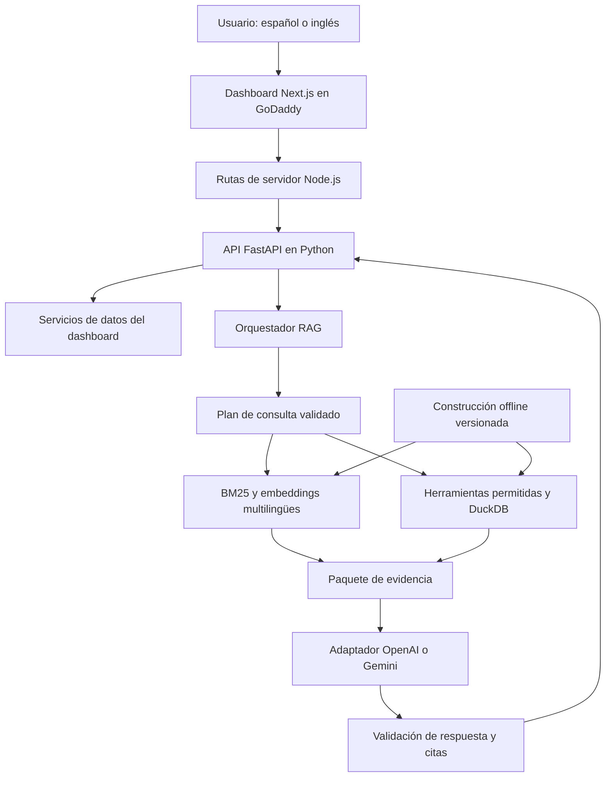

# Plan vigente de RAG y migración del dashboard a Node.js

> **PLAN VIGENTE — SEGUIR ESTE DOCUMENTO.** Desde el **2026-11-15**, este es el plan de referencia para implementar el RAG y migrar el dashboard. Prevalece, en caso de contradicción, sobre el diseño RAG anterior, la especificación Streamlit y las decisiones tecnológicas anteriores relativas a estas capas. Los colaboradores y agentes deben seguirlo; cualquier cambio de arquitectura o alcance debe documentarse mediante un ADR y actualizar este plan antes de implementarse.
>
> **Estado: implementación local del piloto disponible; aceptación y publicación pendientes.** Consultar [RAG_RUNBOOK.md](RAG_RUNBOOK.md) para comandos, capacidades y límites verificados, y [ADR-0008](../01_management/decisions/ADR-0008-rag-extractive-baseline.md) para el contrato extractivo inicial. No confundir entrega local con aprobación científica, autorización de gasto o autorización de publicación. Las fases y gates de este plan siguen vigentes.

- **Decisión de arquitectura:** [ADR-0004](../01_management/decisions/ADR-0004-rag-web-architecture.md).
- **Visión de producto y alcance de las lecturas del modelo (2026-11-15):** [PRODUCT_VISION.md](../05_dashboard/PRODUCT_VISION.md) y [ADR-0007](../01_management/decisions/ADR-0007-evidence-tiers-in-dashboard.md). Se incorpora su distinción entre lecturas controladas del dashboard y ausencia de predicciones en chat. El piloto mantiene activo el bloqueo de publicación hasta revisión de artefactos.
- **Base inspeccionada:** commit `b1efca2`. Volver a comprobar el repositorio antes de implementar.
- **Alcance:** tareas RAG-01 a RAG-05 y migración de las páginas APP; las fases de ejecución se detallan en la sección 17.
- **Documentos anteriores:** [RAG_DESIGN.md](RAG_DESIGN.md), [DASHBOARD_SPEC.md](../05_dashboard/DASHBOARD_SPEC.md) y [ADR-0001](../01_management/decisions/ADR-0001-tech-stack.md) se conservan como antecedentes. Sus instrucciones incompatibles no deben guiar trabajo nuevo.
- **Límite de precedencia:** este plan no sustituye las reglas científicas, contratos de datos, aprobaciones PHY ni instrucciones explícitas posteriores del responsable del proyecto. No redefine fases ajenas a RAG/dashboard del plan ejecutivo.

## 1. Decisiones y objetivo de la primera versión

Las decisiones confirmadas para esta planificación son:

| Aspecto | Decisión |
|---|---|
| Preguntas soportadas | Documentos y consultas exactas sobre tablas gold |
| Idiomas del asistente | Español e inglés |
| Embeddings | Modelo local, compacto y multilingüe |
| Dashboard | Migración completa a una aplicación Node.js |
| Hosting web | GoDaddy para la aplicación Node.js y el dominio |
| Backend Python | Se permite un proveedor de hosting separado |
| Generación | Describir e implementar adaptadores para OpenAI y Gemini; proveedor activo aún por decidir |
| Predicciones | Chat sin predicciones. Dashboard: lecturas controladas según ADR-0007, bloqueadas hasta artefacto y validación; no inventar tiers ni cifras |

El objetivo es responder con evidencia trazable, distinguir poblaciones experimentales y permitir inspeccionar las fuentes y consultas que respaldan cada respuesta.

| Tipo de pregunta | Ejemplo | Ejecución |
|---|---|---|
| Documental | «¿De dónde viene `burn_time_s`?» | Recuperar definiciones y documentación citada |
| Estructurada | «¿Cuántas pruebas inversas de CFI-G tienen resultado flash?» | Consulta parametrizada y validada |
| Mixta | «Compara resultados de ignición y explica la diferencia con Flame Design» | Herramientas tabulares más recuperación documental |
| Navegación | «Muéstrame las investigaciones sobre helio» | Rutas y filtros permitidos del dashboard |

La primera versión no entrenará modelos, ejecutará SQL/Python arbitrario, navegará autónomamente por internet ni admitirá cargas documentales arbitrarias. No presentará frecuencias experimentales como riesgo de misión ni extrapolaciones lunares/marcianas como datos medidos. Ante una petición predictiva explicará el límite y ofrecerá, cuando proceda, la cobertura experimental disponible.

## 2. Estado real del repositorio

| Componente | Estado de la base inspeccionada | Consecuencia |
|---|---|---|
| `src/flamesafe/rag/` | Paquete sin implementación funcional | Construir recuperación, generación y validación |
| `configs/rag.yaml` | Anthropic y embeddings en inglés | Cambiar en implementación conforme al ADR-0004 |
| `flamesafe rag-index` | Comando pendiente | Implementar construcción offline |
| `app/` | Estructura Streamlit, páginas mayormente pendientes | Crear reemplazo en `web/` |
| Gold y DuckDB | Implementados | Reutilizar para consultas exactas |
| Auditoría y segmentación | Implementadas | Reutilizar identidad, cronología y definiciones |
| M-01 | Candidato con revisión PHY pendiente | No publicar predicciones ni resultados no aprobados |
| Findings | Solo plantilla en la base inspeccionada | Un corpus de findings aprobados vacío es válido |

Conteos observados en el gold local de esta base:

| Tabla | Filas | Interpretación |
|---|---:|---|
| `investigations` | 24 | Catálogo de investigaciones |
| `publications` | 303 | Metadatos bibliográficos |
| `gas_flame_tests` | 660 | Experimentos de gas de campañas y geometrías diferentes |
| `droplet_tests` | 501 | Experimentos de gotas |
| `droplet_reference_points` | 15 861 | Puntos digitalizados con distintos roles, incluidas curvas de modelo |

Estos conteos describen una instantánea: no fijarlos como constantes de la aplicación. La tabla `publications` contiene título, autores y DOI, pero **no abstracts**. Los puntos digitalizados no equivalen a miles de experimentos independientes. Un clon normal contiene muestras, no necesariamente los datos completos del entorno de trabajo inspeccionado.

## 3. Arquitectura objetivo y responsabilidades



| Capa | Responsabilidad |
|---|---|
| Next.js y TypeScript | Páginas, chat, gráficas y navegación |
| Servidor Node.js | Gateway del mismo origen, sesión y validación de peticiones |
| FastAPI/Python | Semántica científica, datos, recuperación y orquestación |
| DuckDB | Consultas exactas sobre una instantánea inmutable |
| Embeddings locales | Representación de documentos y preguntas |
| OpenAI/Gemini | Interpretación de preguntas y redacción basada en evidencia |

**Python sigue siendo la autoridad de los datos y de las reglas científicas.** No duplicar en JavaScript las conversiones, cohortes o reglas de auditoría. El navegador llama al gateway Node.js; este llama a Python con autenticación entre servidores.

Next.js puede ejecutarse como servidor Node.js. GoDaddy exige un `package.json` en la raíz de la aplicación, scripts de construcción/arranque y escuchar el puerto asignado. Empaquetar `web/` como raíz del despliegue web, sin trasladar la raíz Python ni añadir una segunda implementación científica.

## 4. Estructura de implementación propuesta

Las siguientes rutas describen trabajo futuro, salvo archivos que ya existan:

```text
configs/
  rag.yaml
  rag_sources.yaml
  rag_tools.yaml
src/flamesafe/
  rag/
    schemas.py
    sources.py
    corpus.py
    chunking.py
    embeddings.py
    index.py
    retrieval.py
    tools.py
    orchestrator.py
    citations.py
    validation.py
    evaluation.py
    providers/
      base.py
      openai.py
      gemini.py
  api/
    main.py
    dependencies.py
    schemas.py
    routes/
      health.py
      dashboard.py
      chat.py
      sources.py
  services/
    dashboard.py
web/
  package.json
  package-lock.json
  src/
    app/
    components/
    lib/
    generated/
contracts/
  openapi.json
tests/
  fixtures/rag/
  unit/test_rag_*.py
  unit/test_api_*.py
  integration/test_rag_*.py
scripts/
  export_openapi.py
deploy/
  Dockerfile.api
  README.md
docs/
  03_data_science/rag_eval.md
  03_data_science/rag_eval.jsonl
  05_dashboard/DEPLOYMENT.md
```

Actualizar también `pyproject.toml`, `uv.lock`, `.env.example`, configuraciones, CLI, CI, README y especificaciones. Introducir extras como `rag-openai`, `rag-gemini` y `api`; mantener opcionales las dependencias de RAG. Revisar referencias antes de retirar la dependencia anterior de Anthropic. Fijar versiones compatibles y el lockfile; no actualizar librerías ajenas sin necesidad.

Las rutas API delegarán en servicios; no contendrán SQL ni lógica científica. Conservar notebooks y pipeline medallion.

## 5. Contratos antes de la recuperación

Definir primero esquemas Pydantic para conducir herramientas, API, adaptadores, pruebas y tipos TypeScript.

| Contrato | Contenido obligatorio |
|---|---|
| `SourceRecord` | ID estable, título, tipo, procedencia, hash, revisión, derechos y localizador |
| `DocumentChunk` | ID de fragmento/fuente, texto, idioma, sección/página y tokens |
| `QueryPlan` | Ruta, filtros normalizados, herramientas y necesidad de aclaración |
| `ToolResult` | Alcance, resultados, unidades, denominadores, procedencia y advertencias |
| `EvidenceBundle` | Fragmentos y resultados disponibles para responder |
| `AnswerResult` | Estado, idioma, afirmaciones, referencias y limitaciones |
| `BuildManifest` | Hashes de entrada, versiones, esquemas, conteos e ID de construcción |

Estados de respuesta: `answered`, `partial`, `clarification_required`, `insufficient_evidence`, `unavailable`.

No confundir ambigüedad con ausencia de datos o fallo de servicio. Por ejemplo: «oxígeno 34» puede requerir aclaración; un filtro sin observaciones indica evidencia insuficiente; un timeout del proveedor indica indisponibilidad; una consulta respaldada sin fuente explicativa puede dar respuesta parcial.

## 6. Corpus documental controlado

**No indexar recursivamente todo el repositorio.** Usar `configs/rag_sources.yaml` como manifiesto explícito.

| Fuente | Política de primera versión |
|---|---|
| Metadatos PSI saneados | Campos descriptivos seleccionados |
| Diccionario de datos | Definiciones revisadas de variables |
| PDFs y ReadMe seleccionados | Tras verificar procedencia y extracción |
| Findings | Solo aprobados |
| Model cards | Metodología, estado y limitaciones; excluir resultados numéricos sin aprobación |
| Física | Secciones revisadas |
| Metadatos de publicaciones | Bibliografía; no evidencia de conclusiones del artículo |
| Abstracts | Solo cuando realmente se hayan adquirido y verificado |
| Plantillas, secretos, logs y outputs de notebooks | Excluidos |
| Registros de contactos | Excluidos |

Cada fuente registrará `source_id`, `source_type`, `title`, `language`, `psi_ids`, `doi`, `original_url`, `local_input_reference`, `sha256`, `review_status`, `reviewed_by`, `reviewed_at`, `approved_sections` y `license_or_terms`.

La aprobación corresponde a una versión o sección concreta; cambiar el hash invalida la revisión asociada. Separar fidelidad de extracción de aprobación de interpretación científica. No declarar aprobado todo un directorio.

### Extracción y duplicados

1. Verificar hashes y sidecars disponibles; no incorporar descargas fallidas.
2. Extraer Markdown por estructura y PDF con página/localizador.
3. Detectar extracción vacía o inutilizable. Separar OCR como tarea explícita para documentos escaneados.
4. Conservar unidades, ecuaciones, encabezados y contexto tabular.
5. Excluir texto sin trazabilidad al original.
6. Deduplicar documentos idénticos por contenido, conservando asociaciones y alias de investigaciones.
7. Normalizar DOI como identidad bibliográfica, sin asumir que identifica una versión de archivo idéntica.
8. Excluir `_TEMPLATE.md` y contenido no elegible.

No heredar automáticamente a los artículos los permisos de los metadatos PSI. Verificar derechos de extracción, envío a proveedores y redistribución por fuente. Los localizadores internos no deben exponer rutas absolutas del equipo del desarrollador.

## 7. Recuperación multilingüe

Modelo inicial recomendado: `intfloat/multilingual-e5-small`, sujeto a evaluación bilingüe. Fijar revisión del modelo; descargar pesos únicamente en un paso explícito de construcción; usar pesos locales en ejecución y desactivar código remoto.

El modelo documenta embeddings de 384 dimensiones, normalización, límite de 512 tokens y prefijos `query: ` para preguntas y `passage: ` para documentos, también en español. Registrar revisión y preprocesamiento; reconstruir el índice ante cambios.

| Parámetro inicial | Valor |
|---|---:|
| Fragmento objetivo | Aproximadamente 300 tokens del embedding |
| Máximo de contenido | 384 tokens del embedding |
| Solapamiento | Aproximadamente 40 tokens |
| Validación final | Prefijo + encabezado + texto dentro del límite del modelo |
| Candidatos BM25 | 30 |
| Candidatos densos | 30 |
| Constante RRF | 60 |
| Fragmentos finales | 8 |

Son valores iniciales para evaluar, no resultados óptimos demostrados. No truncar silenciosamente. Dividir tablas demasiado grandes en grupos de filas con encabezados, unidades e identidad de tabla repetidos.

Mantener BM25, embeddings y LanceDB, combinados mediante Reciprocal Rank Fusion. Priorizar coincidencias exactas de variables, identificadores PSI y DOI; aplicar filtros de metadatos, quitar solapamientos redundantes y limitar por defecto la dominancia de una sola fuente. Relajar diversidad para preguntas sobre un documento concreto.

Incluir un glosario bilingüe controlado para términos técnicos. No traducir toda la documentación automáticamente ni tratar traducciones como fuentes independientes. No interpretar el score RRF como probabilidad de verdad; calibrar abstención con evaluación.

## 8. Subsistema de consultas exactas

Los embeddings no calcularán conteos, porcentajes, medianas ni rangos. Crear un registro pequeño de herramientas:

| Herramienta | Propósito |
|---|---|
| `find_investigations` | Filtros y búsqueda de catálogo |
| `get_investigation` | Ficha y cobertura |
| `find_publications` | Búsqueda bibliográfica |
| `summarize_gas_tests` | Conteos y resúmenes numéricos acotados |
| `summarize_ignition_outcomes` | Resultados con denominador explícito |
| `list_gas_tests` | Inspección acotada de filas trazables |
| `summarize_droplet_tests` | Resúmenes de gotas por ámbito compatible |
| `summarize_reference_points` | Conteos de puntos separados por rol |
| `get_variable_definition` | Definición, unidades, origen y aplicabilidad |

Ejemplo de petición validable:

```json
{
  "tool": "summarize_ignition_outcomes",
  "arguments": {
    "campaign": "CFI-G",
    "flame_type": "inverse",
    "cohort": "raw_gold",
    "group_by": ["ignition_outcome"]
  }
}
```

El modelo selecciona nombres y argumentos, **nunca SQL ejecutable**. Resolver tablas, columnas, agregaciones y agrupaciones mediante listas permitidas del servidor; enlazar valores como parámetros. DuckDB en modo lectura no convierte SQL arbitrario en seguro: el motor tiene capacidades de archivos, extensiones y red. Aplicar también límites de tiempo/recursos y configuración restrictiva verificada para la versión fijada.

Todo resultado incluirá `tool_name`, `template_version`, `normalized_parameters`, `dataset_build_id`, `population_or_cohort`, `n_rows`, `n_unique_tests` cuando aplique, `n_operations` si está disponible, `n_valid_by_variable`, `n_missing_by_variable`, `units`, `results`, `warnings`, `provenance_reference` y `result_hash`.

- Conteos de operaciones no disponibles y estadísticas de conjuntos vacíos serán `null`, no cero.
- Declarar denominadores de porcentajes; separar etiquetas ausentes de resultados negativos.
- Validar cardinalidad de joins. No multiplicar pruebas por publicaciones o EventData.
- Marcar previews como previews; nunca calcular totales a partir de filas truncadas.
- Permitir conteos, faltantes, mínimo/máximo, mediana/cuartiles, frecuencias y cobertura.
- Mantener tests de hipótesis, causalidad, predicciones y cálculos arbitrarios fuera del contrato inicial.

## 9. Límites científicos y poblaciones

| Asunto | Conducta requerida |
|---|---|
| CFI-G / Flame Design | Conservar campaña y fuente de resultado |
| `flash` | Categoría propia; no convertir silenciosamente a falso |
| Ignición ausente | Desconocida, no negativa |
| Normal / inversa | Respetar significado físico de condiciones y caudales |
| `m_n2_mg_s` | Respetar aplicabilidad por campaña y definición original |
| `burn_time_s` | Procedencia documentada por campaña; no confundir con duración de EventData |
| Corte de flujo | Intervención distinta de extinción natural; no es tiempo de evacuación |
| Tasa FLEX | Conservar condición de unidades pendientes de verificación |
| Variables derivadas | Distinguir cálculo de valores reportados |
| Puntos digitalizados | Separar experimentos, modelos, barras de error y rol desconocido |
| Fechas/condiciones repetidas | No justifican por sí solas borrar experimentos |
| Gravedad parcial | No presentar extrapolación como medición |

Reutilizar `analysis/segmentation.py` para identidad y cronología de gas. Sus operaciones son bloques operativos, no muestras independientes demostradas. Definir y publicar ámbitos como `raw_gold`, `audited_unique` y `audited_verified_dates`; no aplicar automáticamente la cohorte de entrenamiento M-01 a toda descripción.

Si un ámbito requiere EventData, incluir sus entradas saneadas en la construcción. No depender de que previamente se haya ejecutado un notebook. Conservar grupos pequeños, controles de flujo cero, protocolos especiales, fechas no verificadas y anomalías como categorías/advertencias o sensibilidades explícitas.

Normalizar porcentajes y presiones solo con unidades explícitas, usando `physics/units.py`. Mantener unidades solicitadas para presentación. Preguntar ante «oxígeno 34» si es ambiguo; no usar oxígeno de llama inversa como atmósfera de cabina. Identificadores internos y accesiones PSI deben resolverse mediante un registro verificado de alias.

## 10. Adaptadores OpenAI y Gemini

Implementar una interfaz común con `generate_structured`, normalización de uso y normalización de errores. Un proveedor activo por despliegue; sin failover automático entre proveedores.

| Aspecto | OpenAI | Gemini |
|---|---|---|
| SDK Python | `openai` | `google-genai` |
| Secreto | `OPENAI_API_KEY` | `GEMINI_API_KEY` |
| Salida | Restringida por esquema | Restringida por esquema |
| Modelo | Configuración explícita | Configuración explícita |
| Coste | Facturación/créditos API separados | Tier gratuito o de pago según cuenta y modelo |
| Recuperación | Local y común | Local y común |

No asumir un modelo gratuito ni fijar un identificador de memoria. Al implementar: verificar modelos vigentes, elegir candidatos con esquemas e idiomas requeridos, evaluar ambos sobre los mismos casos y registrar identificadores, versiones SDK, calidad, latencia y coste. Una salida compatible con JSON Schema sigue requiriendo validación de negocio, gestión de rechazo y respuestas incompletas.

La facturación API OpenAI y los posibles beneficios de créditos deben verificarse en la cuenta; una suscripción ChatGPT no debe darse por financiación automática de la aplicación. Gemini gratuito tiene límites y términos de uso de contenido distintos de servicios de pago: enviar solo material elegible e informar sobre tratamiento de preguntas. No activar facturación de pago automáticamente al agotar cuota gratuita.

## 11. Orquestación acotada y validación de respuestas

Secuencia de una petición:

1. Validar longitud, idioma y contexto acotado.
2. Resolver identificadores y filtros explícitos.
3. Producir un plan tipado y validarlo.
4. Recuperar documentos y ejecutar herramientas permitidas.
5. Construir el paquete de evidencia.
6. Generar respuesta estructurada.
7. Validar afirmaciones y citas.
8. Renderizar salida aprobada.

Límites iniciales: máximo dos ejecuciones de herramientas, ocho fragmentos recuperados y tres llamadas al proveedor incluyendo una reparación opcional. Sin bucles autónomos ni reintentos ilimitados. Si hay ambigüedad científica, solicitar aclaración en lugar de inventar filtros.

Cada afirmación tendrá `kind` (`data`, `interpretation`, `limitation`), `text`, `evidence_ids` y `numeric_fact_ids`. La aplicación genera etiquetas/enlaces de citas, números exactos, unidades, denominadores y ámbito de datos. Para resultados tabulares, preferir plantillas numéricas renderizadas por servidor; el modelo explica sin reconstruir valores de memoria.

Los números documentales requieren un extracto verificable o un hecho numérico curado; citar un artículo completo no basta. Rechazar IDs desconocidos, referencias ajenas a la evidencia suministrada, números sin respaldo, unidades/ámbitos ausentes cuando correspondan, predicciones, resultados no aprobados y URLs arbitrarias generadas.

Permitir una reparación acotada y después devolver una respuesta parcial segura o evidencia insuficiente. Que una cita exista no prueba que respalde semánticamente la redacción: evaluar esto con revisión humana. Se pueden emitir mensajes de progreso, pero mostrar la respuesta final solo después de validarla.

El historial de conversación no es una fuente: volver a recuperar evidencia por petición. Acotar turnos/tokens y no persistir preguntas completas por defecto.

## 12. API Python versionada

| Endpoint propuesto | Uso |
|---|---|
| `GET /health/live` | Proceso disponible |
| `GET /health/ready` | Artefactos, esquemas y modelo local listos |
| `GET /v1/status` | Instantánea y capacidades habilitadas |
| `GET /v1/investigations` | Catálogo filtrado |
| `GET /v1/investigations/{id}` | Ficha |
| `GET /v1/variables/{name}` | Definición y aplicabilidad |
| `POST /v1/data/query` | Petición tipada de herramienta; nunca SQL |
| `POST /v1/chat` | RAG bilingüe |
| `GET /v1/sources/{id}` | Fuente saneada |
| `GET /v1/evidence/{id}` | Evidencia reproducible |

Generar OpenAPI desde Python y tipos TypeScript desde ese contrato; CI detectará divergencias. Los IDs de evidencia deben identificar la construcción y permitir reconstruir el resultado o recuperarlo con una política explícita de retención. No exponer rutas absolutas ni consultas ejecutables del usuario.

Una carga de embeddings por worker, concurrencia acotada, conexiones DuckDB gestionadas con seguridad y timeouts de consultas/proveedor. No bloquear el event loop con inferencia de embeddings. Serializar faltantes como `null`, nunca JSON `NaN`.

No indexar, descargar ni entrenar dentro de una petición HTTP. Comenzar con un worker Python y medir memoria antes de aumentarlos: varios workers pueden duplicar pesos en RAM. Diferenciar disponibilidad del servicio de disponibilidad del proveedor; sin API key el modo de evidencia puede seguir listo.

## 13. Migración completa del dashboard

Next.js/TypeScript con layout compartido. Mantener UI en inglés conforme a la convención actual y respuestas del chat en español o inglés.

| Página anterior | Ruta propuesta | Comportamiento inicial |
|---|---|---|
| Home | `/` | Cobertura calculada desde instantánea y navegación |
| Mission Brief | `/mission` | Contenido explicativo revisado |
| Investigation Explorer | `/investigations` | Filtros, fichas, publicaciones y cobertura |
| Compare | `/compare` | Resúmenes compatibles lado a lado |
| Insights | `/insights` | Findings aprobados o estado vacío explícito |
| Habitat Risk Explorer | `/habitat` | Cobertura y estado de revisión; lecturas controladas ADR-0007 solo tras validación. Piloto con bloqueo activo |
| Ask the Data | `/ask` | RAG bilingüe |
| Methods & Sources | `/methods` | Procedencia, limitaciones, definiciones y construcción |

Migrar todas las rutas no autoriza resultados científicos no aprobados. No inventar scores de ranking ni findings para llenar pantallas. Mantener controles predictivos inhabilitados hasta que se satisfagan los requisitos de artefacto, validación y publicación de ADR-0007; distinguir disponibilidad bibliográfica de conclusiones de los artículos.

Componentes compartidos: fuentes, tipo/revisión de evidencia, ámbito e instantánea, cobertura/faltantes, unidades, carga/vacío/indisponibilidad y tablas expandibles. Python entrega series numéricas tipadas para Plotly/React; no ejecutar código de gráficas generado por el modelo.

El chat muestra respuesta, población/filtros, referencias, resultados exactos pertinentes, limitaciones y enlaces construidos con identificadores de rutas permitidos. Permitir filtros compartibles por URL. Mantener Streamlit durante la transición; retirar su ruta de despliegue solo tras aceptación del reemplazo.

## 14. Artefactos reproducibles

```text
artifacts/rag/<build_id>/
  manifest.json
  sources.jsonl
  chunks.jsonl
  bm25/
  vectors/
  query_snapshot.duckdb
  reports/
```

Registrar commit, hashes y conteos de entradas, elegibilidad de fuentes, revisión del embedding, tokenizador/chunking, versiones de herramientas/esquemas/dependencias y referencias de evaluación. Serializar datos de índices con formatos controlados; no cargar pickle arbitrario.

Construir en ubicación temporal, validar todo y activar únicamente una construcción completa. Conservar anterior para rollback. No mezclar índice nuevo y DuckDB viejo. Una réplica captura la versión al iniciar y las peticiones mantienen esa versión hasta terminar.

Clave de caché: pregunta/contexto, idioma, filtros normalizados, construcción, proveedor/modelo y versión de prompt/esquema. Un cambio de evidencia invalida caché y respuestas demo relacionadas.

Modos explícitos: `sample` (muestras versionadas y etiquetadas), `full` (entradas completas validadas), `test` (fixtures controlados). Nunca sustituir datos completos por muestras silenciosamente. Los ficheros completos y pesos no deben incluirse en Git como solución al despliegue: distribuir mediante un bundle/imagen autorizado y verificable.

## 15. Hosting, secretos y presupuesto

### GoDaddy y backend separado

Desplegar `web/` como raíz Node.js. Verificar en la cuenta real runtime, instalación de dependencias para build, scripts, puerto, secretos de servidor y timeout. Las guías actuales de GoDaddy describen Node.js; no asumir soporte para el proceso Python/embeddings.

Usar hosting compatible con contenedores para Python. Render es una opción documentada, no una compra autorizada. Seleccionar recursos tras medir memoria y latencia; no prometer que un tier gratuito será suficiente.

Empaquetar aplicación, pesos locales, bundle inmutable y dependencias fijadas. Ejecutar sin root; entradas de runtime en solo lectura. No descargar pesos ni construir corpus al primer usuario. Configurar rutas de datos absolutas y comprobar readiness independientemente del directorio de trabajo.

### Secretos y límites

`OPENAI_API_KEY`, `GEMINI_API_KEY` y `FLAMESAFE_BACKEND_TOKEN` serán secretos de servidor, nunca `NEXT_PUBLIC_*`, assets del navegador, logs ni descargas de fuentes. CORS no sustituye autenticación; el gateway solo reenviará rutas y destinos permitidos.

Antes de acceso público: límites por sesión/globales, concurrencia, tokens de entrada/salida, presupuestos diarios/mensuales, interruptor de generación y contabilidad de reintentos. Reservar presupuesto de forma atómica antes de llamadas; contabilizar intentos potencialmente facturables. Sin presupuesto configurado, generación de pago deshabilitada.

Para una única instancia Python puede usarse un ledger SQLite durable con reservas atómicas y almacenamiento persistente, probado frente a reinicios. Evitar escritores de dos despliegues simultáneos; pasar a un almacén transaccional compartido antes de escalar horizontalmente. Verificar restricciones del disco persistente sobre rollout/rollback del host. Los artefactos científicos siguen siendo inmutables, separados del ledger.

Mantener dashboard y consultas de evidencia sin generación al agotar presupuesto. No cambiar proveedor o modalidad de facturación automáticamente. Los costes de hosting, almacenamiento y API son conceptos separados.

## 16. Seguridad y fallos

El texto recuperado es evidencia, no instrucciones. Probar documentos que pidan ignorar reglas, revelar secretos, alterar argumentos, ejecutar comandos o seguir URLs; nunca conceder capacidades por contenido del corpus.

Aplicar esquemas estrictos, paginación y resultados acotados, Markdown saneado, enlaces seguros, destino backend fijo, proxy restringido y logs mínimos sin secretos ni preguntas sensibles completas.

| Fallo | Conducta |
|---|---|
| Sin API key | Dashboard y modo de evidencia disponibles |
| Cuota agotada | Explicar indisponibilidad de generación |
| Timeout | Fallo acotado, preservar evidencia disponible |
| Cita inválida | Reparar una vez; rechazar lo no respaldado |
| Artefacto corrupto | Readiness fallida; conservar despliegue anterior |
| Revisión científica ausente | Mostrar estado y retener afirmaciones dependientes |
| Sin observaciones | Devolver cobertura vacía con ámbito explícito |

## 17. Ejecución por fases y cambios revisables

| Fase | Trabajo | Criterio de salida |
|---|---|---|
| 0. Base y decisión | Leer instrucciones, comprobar commit/rama, revisar ADR-0004 y este plan | Contratos y alcance comprendidos; baseline documentada |
| 1. Esquemas y fixtures | Contratos, ejemplos y casos científicos pequeños | Validación sin red |
| 2. Herramientas | Instantánea, consultas permitidas, unidades, cohortes y procedencia | Resultados exactos sin multiplicar filas |
| 3. Corpus | Registro, extracción, elegibilidad, deduplicación y chunking | Todo fragmento trazable |
| 4. Recuperación | Modelo local, BM25, índice denso, RRF y filtros | Benchmark bilingüe aprobado |
| 5. Generación | Adaptadores, planificación, orquestación y validación | Ambos adaptadores pasan contratos |
| 6. API | Rutas, health, autenticación y contrato generado | Python y TypeScript compatibles |
| 7. Dashboard | Todas las rutas y estados científicos pendientes | Funciona con fixtures e instantáneas reales |
| 8. Evaluación | Offline, proveedores, científica y adversarial | Gates del proveedor habilitado aprobados |
| 9. Preparación de despliegue | Contenedor, paquete GoDaddy, secretos/presupuesto, staging y rollback | Resultado revisable; publicación requiere autorización |
| 10. Cutover | Cambiar entrada principal y deprecar despliegue Streamlit | Reemplazo aceptado y publicación autorizada |

Relacionar cambios con RAG-01 a RAG-05 y tareas APP existentes; usar ramas y commits según `CONTRIBUTING.md`. No presentar implementación pendiente como progreso completado ni cerrar gates sin pruebas. Mantener PRs revisables; sin force-push compartido ni cambios ajenos de notebooks/pipeline.

## 18. Verificación y criterios de aceptación

### Pruebas de herramientas y servicios

Cubrir faltantes frente a cero, `no` frente a desconocido, categorías constantes, grupos pequeños, `yes`/`no`/`flash`/ausentes, consultas vacías, identidades duplicadas/conflictivas, fechas inválidas/ausentes, caudales por geometría, diferencias de etiquetas por campaña, unidades FLEX pendientes y roles de puntos.

Probar filtros maliciosos, SQL inyectado, citas inventadas, negativa/salida inválida/timeout/cuota de proveedor, reservas de presupuesto concurrentes/reinicio y diferenciación sample/full. CI ordinaria sin llamadas pagadas ni descarga de pesos: proveedores y embeddings controlados. Separar pruebas reales de recuperación local e integración de proveedor.

### Evaluación bilingüe

Crear al menos 60 preguntas: 30 casos semánticos en español e inglés. Mantener traducciones de un mismo caso juntas al separar desarrollo y evaluación reservada. Cada caso debe especificar idioma, alcance, respuesta o abstención esperada, evidencia y hechos numéricos esperados, vinculados a una instantánea.

Incluir preguntas reales sobre origen de `burn_time_s`, `flash`, etiquetas Flame Design/CFI-G, nitrógeno, unidades FLEX, puntos digitalizados y ausencia de evidencia lunar.

| Métrica | Gate propuesto |
|---|---:|
| Evidencia relevante recuperada en top 8 | ≥90% |
| Herramienta y ámbito correctos | ≥95% |
| IDs de cita existentes y resolubles | 100% |
| Citas que respaldan afirmaciones | ≥95% |
| Respuesta correcta global | ≥85% |
| Afirmaciones numéricas sin respaldo | 0 en evaluación de release |
| Manejo correcto de casos designados sin respuesta | 100% |
| Exposición de secretos o SQL ejecutable del usuario | 0 |

Son criterios sobre un conjunto definido, no garantías universales. Reportar español e inglés por separado. La evaluación offline no sustituye evaluación real de generación para el proveedor/modelo que se publique.

### Dashboard y no regresión

Verificar todas las rutas directas/navegación, URLs compartibles, unidades y fuentes, móvil/teclado, referencias a la instantánea correcta, funcionamiento sin keys, predicciones inhabilitadas, fallos legibles y ausencia de secretos en assets. Inspeccionar visualmente figuras/estados y registrar evidencia.

Ejecutar lint y pruebas relevantes existentes; confirmar que gold/silver, notebooks y definiciones científicas no cambiaron. No instalar dependencias, descargar modelos o ejecutar pruebas live sin indicar sus requisitos y costes.

## 19. Interfaz de desarrollo propuesta

**Estos comandos son objetivos de implementación. No todos existen hoy.** El agente debe implementarlos/documentarlos antes de anunciarlos como operativos. Ejecutarlos solo durante la fase autorizada, no al publicar este plan.

```powershell
# Tras actualizar extras y lockfile.
uv sync --extra pipeline --extra rag --extra rag-openai --extra rag-gemini --extra api --extra dev

# Construcción sample; descarga de pesos explícita.
uv run flamesafe rag-index --source-mode sample --allow-model-download
uv run flamesafe rag-validate
uv run flamesafe rag-eval --offline
uv run flamesafe rag-ask --language es --evidence-only --question "¿Cómo se registran los casos flash?"

# API local.
uv run uvicorn flamesafe.api.main:app --host 127.0.0.1 --port 8000

# Verificación Python.
uv run ruff check src tests app
uv run pytest -m "not integration"

# Dashboard Node.js.
npm --prefix web ci
npm --prefix web run lint
npm --prefix web run typecheck
npm --prefix web test
npm --prefix web run build
npm --prefix web run dev
```

La evaluación live requiere selección explícita de proveedor y presupuesto; documentar envío de contenido y posible coste. En despliegues usar instalación reproducible con lockfiles y sin resolución dinámica de versiones.

## 20. Handoff para el agente implementador

> Seguir este plan vigente y ADR-0004. Releer instrucciones y comprobar rama/base antes de editar: el repositorio puede haber cambiado. Si hay una incompatibilidad material con la base, documentarla y actualizar el plan/ADR correspondiente; no volver silenciosamente a la arquitectura anterior.
>
> Preservar gold/silver, notebooks y comportamiento analítico. Reutilizar conversiones y auditoría Python; no mezclar poblaciones incompatibles, redefinir ignición ni resolver unidades pendientes por suposición.
>
> Construir Next.js en `web/`, FastAPI en `src/flamesafe/api/` y RAG en `src/flamesafe/rag/`. Mantener Python como autoridad científica. Implementar herramientas tipadas antes de generación, embeddings locales multilingües y evidencia versionada.
>
> Implementar adaptadores OpenAI/Gemini con selección explícita de despliegue. Nunca ejecutar SQL, Python, URLs o código de gráficas suministrado por el modelo. Toda afirmación factual debe remitir a evidencia; conservar unidades, ámbito, faltantes, denominadores e identidad de instantánea.
>
> Migrar todas las páginas; mantener predicciones/resultados no aprobados sin publicar. No inventar ranking ni findings para completar la UI. Completar pruebas, evaluación bilingüe, revisión visual, empaquetado y rollback antes del cutover.
>
> Reportar pruebas aprobadas y dependencias de revisión científica, credenciales o hosting. No comprar hosting, habilitar facturación pagada, exponer secretos, publicar ni cambiar DNS como parte de la preparación de implementación.

Pendientes para despliegue: capacidades de la cuenta GoDaddy, host/recursos Python, proveedor/modelo activo y límites de gasto. No impiden construir y probar localmente con fixtures y modo de evidencia. La firma PHY sigue siendo independiente de la aprobación de este plan.

## Referencias técnicas y mantenimiento

Referencias consultadas para la planificación del 2026-11-15; verificar compatibilidad y condiciones actuales al implementar:

- [Next.js: despliegue](https://nextjs.org/docs/app/getting-started/deploying).
- [GoDaddy: requisitos Node.js](https://developer.godaddy.com/en/docs/api-users/hosting/app-requirements) y [alcance del hosting API](https://developer.godaddy.com/en/docs/api-users/hosting).
- [Multilingual E5: model card](https://huggingface.co/intfloat/multilingual-e5-small).
- [DuckDB: modelo de seguridad](https://duckdb.org/security).
- [OpenAI: salidas estructuradas](https://developers.openai.com/api/docs/guides/structured-outputs?api-mode=responses) y [créditos API elegibles](https://developers.openai.com/api/docs/guides/chatgpt-api-credits).
- [Gemini: salidas estructuradas](https://ai.google.dev/gemini-api/docs/structured-output), [precios](https://ai.google.dev/gemini-api/docs/pricing) y [términos](https://ai.google.dev/gemini-api/terms).
- [FastAPI: contenedores y workers](https://fastapi.tiangolo.com/deployment/docker/).
- [Render: Docker](https://render.com/docs/docker).

Para modificar este plan: explicar el cambio, registrar ADR cuando afecte arquitectura/alcance, actualizar enlaces y avisos de precedencia, y conservar trazabilidad de lo sustituido. No mantener dos planes incompatibles con estado vigente.
